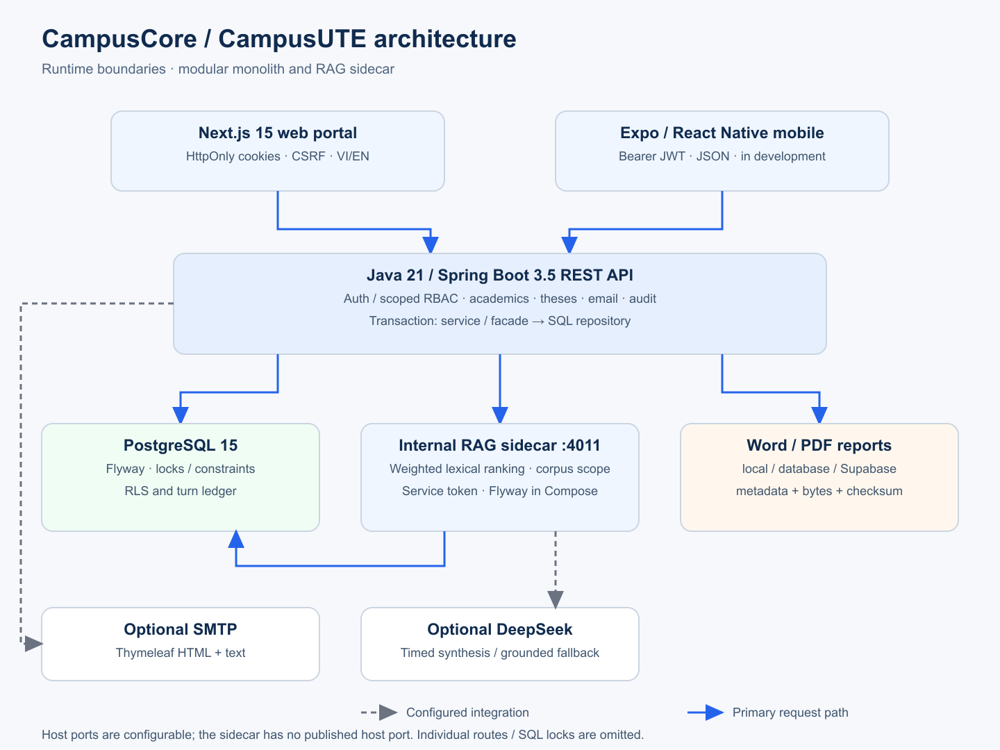
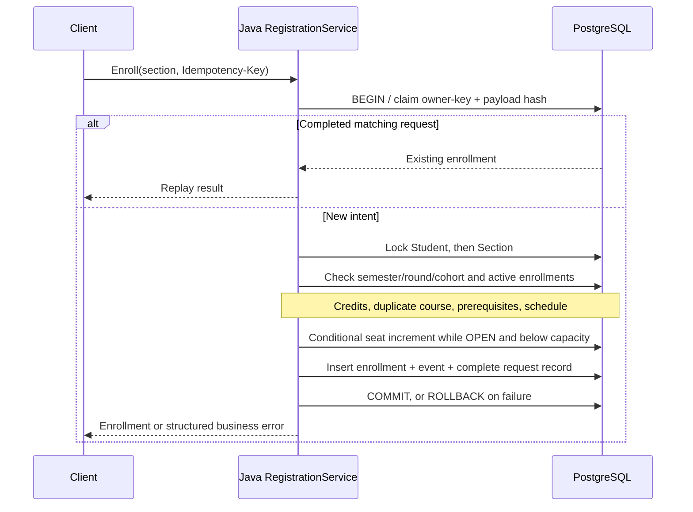
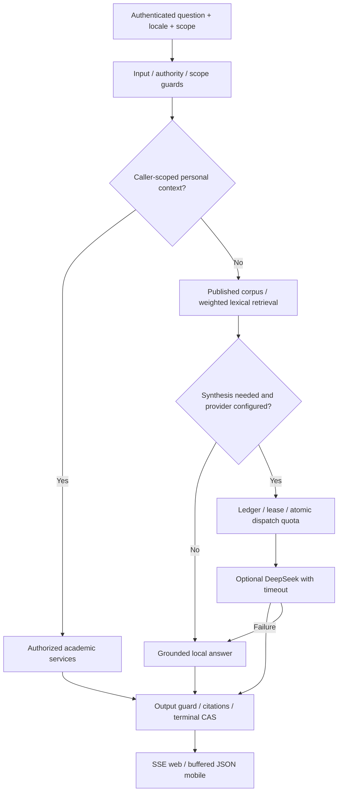
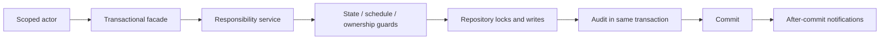

# CampusCore — Architecture and engineering boundaries

[Tiếng Việt: kỹ thuật kiến trúc](technical/architecture-security.vi.md) · [English: architecture techniques](technical/architecture-security.en.md) · [Full technical index](technical/README.en.md)

[English SVG](assets/showcase-2026-10/architecture-en.svg) · [Vietnamese diagram](assets/showcase-2026-10/architecture-vi.png) · [Local capture provenance](assets/showcase-2026-10/provenance.json)

## 1. Runtime ownership

CampusCore is a Java modular monolith with domain-organized packages. Next.js provides the bilingual web portal and same-origin BFF; Expo is a developing mobile client. A private RAG sidecar runs the same Java artifact in a separate mode. PostgreSQL/Flyway owns persisted state. Report bytes may use local, database or private Supabase storage. SMTP and DeepSeek are configured integrations.

The [Compose file](../docker-compose.yml) owns ports, health dependencies and runtime flags. In that stack, the assistant-role provisioner runs before migrations, the sidecar runs Flyway, and the REST API disables Flyway. The sidecar's 4011 port is internal; authenticated user-facing assistant endpoints remain available through the public API.

The web uses HttpOnly access/refresh cookies with `SameSite=Lax`, a CSRF cookie and a custom filter. Mobile uses Bearer access tokens and body refresh tokens; this does not imply an OAuth authorization-server flow. Current account authority and credential revision are checked beyond the JWT signature. Read [authorization and session boundaries](security/authorization-model.md).

## 2. Data ownership

Schema/domain ownership follows the [migrations](../java-services/restful-api/src/main/resources/db/migration/) and [entity/schema mapping tests](../java-services/restful-api/src/test/java/io/campuscore/restfulapi/ArchitectureGuardTest.java). Auth identities, academic profiles/enrollments, thesis rounds/groups/topics/councils, governed assistant knowledge and communication data have distinct owners. Directory identifiers, login identities and student codes must not be treated as interchangeable.

PostgreSQL constraints/triggers supplement service guards. JPA mappings do not mean all transactions use JPA; most business flows use explicit JDBC, with the allowed islands and migration constraints described below. Report metadata is persisted separately from external object bytes; see [report storage](integrations/thesis-report-storage.md).

## 3. Enrollment transaction

[RegistrationService](../java-services/restful-api/src/main/java/io/campuscore/restfulapi/academic/registration/service/RegistrationService.java) owns the exact statement/lock order. Partial unique indexes reject conflicting active records. A row lock serializes access to that contested record; it does not automatically upgrade every query to serializable isolation. Reconciliation detects seat-counter drift; automatic repair defaults off. Read [academic techniques](technical/academic.en.md) for curriculum, grading, appeals and attendance.

## 4. Assistant dispatch and persistence

The actual service has additional conversational, off-topic and recovery branches. This diagram is an orientation map, not a replacement for [ThesisAssistantService](../java-services/restful-api/src/main/java/io/campuscore/restfulapi/thesis/assistant/service/ThesisAssistantService.java). Ranking uses title/content substring and whole-word weights 3/1/4/2, not BM25. Quota applies according to dispatch branches and campus-day buckets. RLS uses a restricted assistant connection and transaction-local identity. Pattern guards do not guarantee complete prompt-injection prevention. Read [AI techniques](technical/assistant-engagement.en.md).

## 5. Thesis writes and governed publication

The [public transactional facade](../java-services/restful-api/src/main/java/io/campuscore/restfulapi/thesis/service/ThesisMutationService.java) delegates round lifecycle, results publication, topic mutation, membership and group governance to responsibility services while retaining the transaction. Controller signatures remain stable.

Round publication rechecks completeness after acquiring the round lock; preview is not a reservation. Reviewer deadlines, report-submission deadlines and defense dates are distinct. Extending counter-review preserves the old inherited report deadline and moves dependent ceremony dates only as required. Read [thesis techniques](technical/thesis.en.md) for the lifecycle, scope, eligibility, artifact integrity, counter-review and council gates.

The remaining sections preserve the repository's implementation conventions. Current executable allowlists and tests remain the authority where a convention has migration exceptions.

---

## 6. Thiết kế Giao diện Người dùng (UI Reference Language)

Giao diện người dùng của CampusCore được thiết kế dựa trên ngôn ngữ nhận diện học vụ của **HCMUTE**:
- **Khung vỏ xanh thể chế (Institutional Blue Shell)**: Màu primary `#003F87` cùng nền sáng `#F9F9FF` và điểm nhấn vàng HCMUTE, định nghĩa tập trung trong `frontend/src/app/globals.css`; giao diện hỗ trợ chủ đề sáng/tối và các biến thể màu accent (ví dụ `river-blue`).
- **Khung vỏ dashboard thống nhất**: Thanh điều hướng trên cùng (điều hướng, chuyển ngữ, đổi theme, chuông thông báo) kèm các thẻ chỉ số học tập dựng bằng `WorkspaceSurface`; khung chat Trợ lý AI là drawer riêng (`AssistantPanel`) và trạng thái cấm truy cập xử lý tập trung qua `WorkspaceForbiddenState`.
- **Bảng dữ liệu xanh đậm (Blue Header Tables)**: Hiển thị dày đặc thông tin điểm số, thời khóa biểu, danh sách lớp học phần theo chuẩn học vụ truyền thống.
- **Xử lý trạng thái tường minh**: Toàn bộ các trạng thái Tải dữ liệu (Loading skeleton), Dữ liệu rỗng (Empty state), Lỗi mạng (Error state), và Cấm truy cập (Forbidden 403) đều được xử lý với thông báo rõ ràng, song ngữ.

Sinh viên cần tra cứu kết quả đăng ký và lịch học cả sau khi đợt đăng ký đóng, nên quyền xem phải độc lập với thời hạn thêm/rút học phần và dữ liệu phải gắn với tài khoản, học kỳ đang xem. Điểm vào: [trang đăng ký](../frontend/src/app/dashboard/register/page.tsx), [tab điều hướng](../frontend/src/components/registration/registration-tabs.tsx) và [khung học phần đã đăng ký](../frontend/src/components/registration/registered-courses-panel.tsx); lịch học dùng [WeeklyGrid](../frontend/src/components/schedule/weekly-grid.tsx). Bằng chứng tương tác nằm trong [kiểm thử trình duyệt](../frontend/e2e/registration-details.spec.ts).

Kết quả chưa xác nhận khi mạng lỗi không được xem là chưa đăng ký: sinh viên cần biết độ tin cậy của dữ liệu trước khi quyết định tín chỉ hoặc lịch học. Ngữ cảnh tab, học kỳ và bộ lọc trong URL phục vụ việc chia sẻ, tải lại và quay về đúng góc nhìn; chủ sở hữu hợp đồng này là trang đăng ký và khung học phần đã đăng ký ở trên. Cùng một buổi học phải có tên thứ thống nhất và thứ tự thời gian rõ ràng ở mọi góc nhìn; ranh giới quy ước ngày học, kể cả dữ liệu Chủ Nhật cũ, nằm tại WeeklyGrid và [hàm xử lý lịch tuần](../frontend/src/lib/weekly-grid.ts). Các trường hợp biên được định nghĩa trong [kiểm thử lịch và nhãn thứ](../frontend/tests/registration-ux.test.js).

Trên màn hình hẹp, truy cập trợ lý phải giữ chỗ cho thao tác học phần và xem lịch; điểm sở hữu lựa chọn hiển thị nút nổi là [AssistantPanel](../frontend/src/components/assistant/AssistantPanel.tsx). Điều hướng bàn phím, tên điều khiển và thông báo lỗi phải giúp sinh viên hiểu trạng thái mà không phụ thuộc màu sắc hoặc thông báo thoáng qua. Các điểm vào là tab điều hướng, trang đăng ký và [nội dung song ngữ](../frontend/src/i18n/messages.ts); kiểm thử trình duyệt ở trên sở hữu các kịch bản tương tác, còn kết quả chạy và bằng chứng phát hành thuộc hồ sơ kế hoạch/phát hành.

---

## 7. Cấu trúc Package Backend (Layered Package Layout)

Backend `java-services/restful-api` (góc `io.campuscore.restfulapi`) được tổ chức theo **module → vai trò (role)** để người đọc tìm code theo chức năng thay vì theo một thư mục phẳng. Mọi lớp nằm trong một package vai trò; chỉ `RestfulApiApplication` ở package gốc. Mỗi module dùng cùng một bộ package con:

| Package | Vai trò |
| --- | --- |
| `controller/` | Chỉ REST controller (`@RestController`/`@Controller`). |
| `dto/` | Các lớp holder request/response (`*Dtos`, record lồng nhau). |
| `service/` | Business services. |
| `repository/` | Data access (JDBC repositories, read ports). |
| `entity/` | JPA `@Entity`/`@Table` types (`thesis.entity.ThesisTopic`, `engagement.entity.Article*`, `academic.entity.*`, `auth.entity.*`). |
| `model/` | Tên duy nhất cho kiểu dữ liệu plain (record/enum/value) dùng chung giữa các tầng: row/projection của repository, command/filter/result của service, status enums. Không phụ thuộc `repository`/`service`/`controller`. Không còn package `domain/` — plain data cũ ở `domain` đã gộp vào `model`, JPA entities đã tách sang `entity`. |
| `config/` | `@Configuration` / `@ConfigurationProperties` của module. |
| `job/` | Scheduled jobs, retention/reconcile jobs. |
| `filter/` | Servlet filters (`security.filter.*`). |
| `scope/` | Authorization/scope helpers (`thesis.scope.ThesisDeanScope`, `ThesisDepartmentScope`). |
| `storage/` | Report-storage implementations (`thesis.storage.*ThesisReportStorage`). |
| `renderer/` | Renderer rõ vai trò (`academic.registration.renderer.RegistrationPdfRenderer`). |

Bản đồ module → subpackage hiện tại:

| Top-level package | Loại | Subpackages |
| --- | --- | --- |
| `academic` | module | `controller`, `dto`, `entity`, `job`, `model`, `repository`, `service`, `registration/{controller,dto,model,renderer,repository,service}` |
| `audit` | module | `controller`, `entity`, `model`, `repository`, `service` |
| `auth` | module | `controller`, `dto`, `entity`, `job`, `model`, `repository`, `service` |
| `engagement` | module | `controller`, `dto`, `entity`, `job`, `model`, `repository`, `service` |
| `mail` | module | `config`, `controller`, `dto`, `model`, `repository`, `service` |
| `notification` | module | `controller`, `dto`, `entity`, `model`, `repository`, `service` |
| `people` | module | `controller`, `dto`, `model`, `repository`, `service` |
| `site` | module | `controller`, `dto`, `entity`, `repository`, `service` |
| `thesis` | module | `config`, `controller`, `dto`, `entity`, `exception`, `model`, `repository`, `scope`, `service`, `storage`, `assistant/{client,config,controller,dto,entity,exception,guard,job,model,properties,repository,rls,service}` |
| `common` | cross-cutting | `dto` (response envelopes), `util` (`LikePattern`) |
| `config` | cross-cutting | `env` (`EnvironmentPostProcessor` đăng ký trong `META-INF/spring.factories`), `jpa` (naming strategy trong `application.yml`), `openapi` |
| `exception` | cross-cutting | `code`, `handler`, `response` (+ các exception base types dùng chung ở package root `exception/` — xem mục Error handling) |
| `security` | cross-cutting | `availability`, `config`, `filter`, `model`, `token`, `ratelimit/{annotation,filter,model,properties,service}` |
| `system` | cross-cutting | `controller` (`Contract`, `Health`), `dto`, `job` (`DatabaseKeepAliveScheduler`) |

`academic.registration` là sub-module của `academic` và tự nó cũng được chia đủ vai trò (`controller`, `dto`, `model`, `repository`, `service`, `renderer`); `thesis.assistant` tương tự với các vai trò riêng (`client` gateways, `guard` input/output, `rls` boundary/context/aspect, `properties`, `job`). Các package `controller/`, `dto/`, `job/` ở root cũ đã bị xóa: `Identity` vào `auth`, `Contract`/`Health`/keep-alive vào `system`; `web/` cũ cũng đã bị xóa hoàn toàn từ vòng refactor trước.

**Thêm module hoặc lớp mới:** tạo `<module>/<role>/TênLớp.java` (một kiểu top-level mỗi file, tên file trùng tên kiểu, visibility tối thiểu). Module business mới bắt đầu bằng `controller`/`service`/`repository` (+`dto`/`model` khi có payload/carrier); không đặt lớp trực tiếp trong package root của module. Plain data (record/enum/value type) luôn vào `model/`; chỉ JPA entity vào `entity/`; tên `domain` không còn được dùng.

**Kiểu dữ liệu lồng nhau:** `record`/`enum`/`interface`/`class` public hoặc protected xuất hiện trong signature không được khai báo bên trong `repository`/`service`/`controller` (kể cả `job`/`client`). Payload request/response serialize ra client đi vào `<module>/dto/`; carrier nội bộ/persistence đi vào `<module>/model/`. Chỉ helper `private`/package-private dùng nội bộ mới được ở lồng.

Quy tắc được bảo đảm bởi `ArchitectureGuardTest` (quét `.class` trên classpath, không cần dependency mới): mọi lớp nằm trong role subpackage (root của mỗi module và các nested root `academic/registration`, `security/ratelimit`, `thesis/assistant` không chứa lớp trực tiếp; chỉ `RestfulApiApplication` ở package gốc); package cross-cutting (`common`, `config`, `exception`, `security`, `system`) không phụ thuộc module business ngoài các cạnh được liệt kê tường minh kèm lý do trong test; `security`/`security.ratelimit` giữ chiều phụ thuộc đã có (filter → service → model/properties; annotation chỉ tham chiếu model); controller chỉ nằm trong package `controller` và phải mang `@RestController`/`@Controller`; package `controller` không phụ thuộc `repository`; `repository` không phụ thuộc `controller`/`service`; các lớp `*Dtos` nằm trong package `dto`; lớp `*Exception` top-level chỉ nằm trong package `..exception..` và phải kế thừa `RuntimeException`/họ `AppException`; exception handler (`*ExceptionHandler`, `@ControllerAdvice`) chỉ nằm trong `..exception.handler..`; package ngoài `exception` không được phụ thuộc `exception.handler`; lớp `*Filter` không được tự serialize body lỗi (không tham chiếu `ObjectMapper`/`PrintWriter` — mọi body lỗi của filter đi qua `ApiErrorWriter`).

**Tên logger và bean theo package mới:** logger SLF4J mang FQN nên các category cũ đổi theo — `….<module>.web` → `….<module>.controller`, `….security` phẳng → `….security.{filter,token,config,model,availability}` + `….security.ratelimit.*`, `….thesis.assistant` phẳng → `….thesis.assistant.{controller,service,repository,rls,guard,client,job,properties,config,dto,model,exception}`, `….config` phẳng → `….config.{env,jpa,openapi}` (keep-alive/health sang `….system.*`), `….common`/`….exception` phẳng → role subpackage tương ứng; bộ lọc log theo package phải dùng tên mới. Bean `@ConfigurationProperties` cũng mang tên `<prefix>-<FQN>` theo package mới (`assistant-….thesis.assistant.properties.*`, `deepseek-….*`, `assistant.rag-….*`, `assistant.supabase-….*`, `thesis.report.storage-….thesis.config.*`) — prefix key không đổi.

### Xử lý lỗi (Error handling)

Mọi quan tâm về exception nằm trong các package riêng theo vai trò:

| Package | Chứa gì |
| --- | --- |
| `exception/` | Exception types dùng chung cho mọi module: `AppException` (base), `DomainException`, `BadRequestException`, `ConflictException`, `ForbiddenException`, `ResourceNotFoundException`, `UnauthorizedException`, `ValidationException`. |
| `exception/code/` | `ErrorCode` — catalog mã lỗi chuẩn kèm HTTP status + message mặc định. |
| `exception/handler/` | `GlobalExceptionHandler` (`@RestControllerAdvice`) — mapper exception → response duy nhất; không chứa gì khác. |
| `exception/response/` | `ErrorResponse` (envelope JSON chuẩn), `ApiErrorWriter` (writer JSON ở tầng filter), `ApiError`/`FieldError` (record đọc error payload upstream của assistant gateways). |
| `<module>/exception/` | Exception riêng của module: `thesis.exception.ThesisReportStorageException`, `thesis.assistant.exception.Provider{Cancelled,Unavailable}Exception`. |

**Nên throw loại nào?** Hai style song song được giữ nguyên (không gộp): `new AppException(ErrorCode.X[, customMessage])` dùng khi lỗi đã có sẵn trong catalog `ErrorCode` — code/status/message đi kèm enum; `new DomainException(status, code, message[, details])` dùng khi cần mã lỗi ad-hoc ngoài catalog hoặc payload `details` cho client xử lý được (ví dụ danh sách conflict ở reopen section). Với các trường hợp phổ biến hơn, dùng typed subclass (`BadRequestException`, `ConflictException`, `ForbiddenException`, `ResourceNotFoundException`, `UnauthorizedException`, `ValidationException` kèm `fieldErrors`). Exception riêng của module (storage/provider) đặt trong `<module>/exception/` — chúng là lỗi kỹ thuật nội bộ, được handler catch-all quy về 500 nếu lọt ra ngoài.

**Hai đường lỗi dùng chung một hình dáng response:** exception từ controller/service đi qua `GlobalExceptionHandler` → record `ErrorResponse` (`timestamp, status, code, message, path, requestId, fieldErrors, fields, details` — field `null` bị ẩn). Lỗi bị chặn ở filter (rate limit, CSRF, body-cap, account-state) đi qua `ApiErrorWriter` và serialize cùng các khóa envelope để client chỉ cần một parser.

**Thêm exception mới cho một module:** tạo lớp `XxxException extends RuntimeException` (hoặc `AppException` nếu cần status/code riêng cho client) trong `<module>/exception/`; nếu cần mã lỗi dùng chung nhiều nơi thì bổ sung hằng vào `exception/code/ErrorCode`; không đặt exception type ngoài package `..exception..` và không thêm handler mới ngoài `exception/handler/` — `ArchitectureGuardTest` sẽ chặn.

---

## 8. Truy cập dữ liệu (Data Access)

**Chuẩn data-access của backend là JDBC** (`NamedParameterJdbcTemplate`, `JdbcTemplate`, `JdbcOperations`). Toàn bộ SQL và row mapping nằm trong package `repository/` của từng module; service sở hữu transaction (`@Transactional`) và thứ tự lời gọi; controller, service và job không chứa câu lệnh SQL. `ArchitectureGuardTest` bắt buộc quy tắc này: tham chiếu tới `org.springframework.jdbc.core` chỉ được phép trong `..repository..`, `..rls..`, `..config..`, ngoại trừ một allow-list chỉ-giảm (shrink-only) các lớp chưa được di chuyển.

**Lớp entity JPA bao phủ toàn bộ bảng base của schema** — mỗi bảng thật có đúng một `@Entity` trong package `entity/` của module sở hữu (`academic.entity`, `auth.entity`, `audit.entity`, `engagement.entity`, `notification.entity`, `site.entity`, `thesis.entity`, `thesis.assistant.entity`). Các entity map từng cột đúng schema/tên bảng/tên cột (kể cả identifier camelCase có dấu ngoặc kép), dùng khoá phức hợp `@IdClass` cho bảng liên kết thuần, và chỉ giữ khoá ngoại dạng cột id (không association graph). `SchemaEntityMappingPostgresIT` kiểm tra mapping bằng `hbm2ddl.auto=validate` trên schema do Flyway migrate, và so khớp tập bảng được map với tập base table trừ danh sách loại trừ được nêu rõ.

**Spring Data repository vẫn bị đóng băng ở hai đảo hiện có** — không thêm repository JPA mới:
- `engagement.entity` — `ArticleCategory`, `ArticleTag`, `ArticleAttachment`, `ArticleMediaGallery` + các Spring Data repository tương ứng; chỉ `ArticleTaxonomyController` sử dụng.
- `thesis.entity` — `ThesisTopic`, `ThesisRegistrationRound` + `thesis.repository.ThesisTopicRepository`, `ThesisRegistrationRoundRepository`; được dùng bên trong các service chủ yếu là JDBC.
- `thesis.assistant.config.AssistantDatabaseConfiguration` — hạ tầng: primary `JpaTransactionManager`, assistant DataSource + `DataSourceTransactionManager` riêng phục vụ RLS, và `NamedParameterJdbcTemplate` beans.

Tham chiếu `jakarta.persistence` chỉ được phép trong các lớp nằm trong `JPA_ISLAND_CLASSES` của `ArchitectureGuardTest` (toàn bộ entity + `AssistantDatabaseConfiguration` + các entity/repository hiện hữu) — guard test chặn mọi tham chiếu mới ngoài allow-list; thêm entity mới đòi hỏi một entry tường minh, reviewable trong danh sách đó.

**Hợp đồng thứ tự khóa (lock order) sống trong SQL:**
- Academic enrollment: `Student -> Section` rồi khóa tập enrollment liên quan; `RegistrationService` đọc đợt bằng `openRoundReadOnly` trong đường enroll, không khóa Round ở bước đó. Auth dùng `User -> Session` và `User -> ResetToken`.
- Thesis có thứ tự theo thao tác, không có một chuỗi `group -> round` chung: tạo nhóm/khôi phục đợt khóa `round -> Student`; membership và governance có chốt khóa nhóm riêng. `ThesisSupervisorService` khóa `round -> topic`. Đọc đúng service/repository của thao tác trước khi sửa khóa.
- Assistant: `conversation -> ledger` (`ThesisAssistantRepository`).
- Phương thức khóa đặt tên `lock...ForUpdate` và chú thích `@Transactional(propagation = MANDATORY)` để không bao giờ chạy ngoài transaction của caller.

**Thêm một câu query mới:** đặt SQL + `RowMapper` trong `repository/` của module; service gọi method đó và sở hữu `@Transactional` khi cần; query `FOR UPDATE`/`FOR SHARE` phải đi qua method `lock...ForUpdate` có `MANDATORY`; exception translation (`DuplicateKeyException`, `DataIntegrityViolationException`, …) ở lại đúng statement trong repository method.

**Không bao giờ chuyển sang JPA:** mọi đường `FOR UPDATE`/`FOR SHARE` và chuỗi lock order; luồng giữ chỗ/idempotency của đăng ký học phần; roster/council/publication/round-restore của thesis; assistant RLS DataSource + turn ledger (`AssistantRlsTransactionRunner` gọi `set_config` per-transaction); các bảng có trigger bảo vệ (thesis group/member, V94/V113/V141); audit writes trong cùng transaction (`AdminAuditRecorder`, `MANDATORY`); read model analytics/dean-overview/report; upsert `ON CONFLICT`. Lý do: thứ tự khóa, ranh giới RLS, trigger bắn trong transaction và việc bắt lỗi theo-từng-statement đều nằm trong SQL — flush trì hoãn của ORM sẽ đổi ngữ nghĩa cả bốn. Boot JPA autoconfig bị exclude trong `application.yml`, `ddl-auto: none` (Flyway sở hữu schema).

---

## 9. Ranh giới ngoài phạm vi (Non-goals)

Các thành phần sau đây được xác định rõ ràng là **nằm ngoài phạm vi của đồ án môn học** để giữ cho hệ thống tập trung vào bài toán cốt lõi:
- **Tài chính & Cổng thanh toán trực tuyến** (Finance, Payment gateways).
- **Phân tích kinh doanh nâng cao & Dashboard BI** (Analytics, Data warehouse).
- **Hệ thống hỗ trợ Helpdesk & Ticket** (Support ticketing system).
- **Hạ tầng phân tán phức tạp**: Cụm Redis, RabbitMQ, Kafka, MinIO, Nginx, Kubernetes, Cloudflare tunnels.
- **Cơ sở dữ liệu Vector chuyên dụng** (Milvus, Pinecone, Qdrant): CampusCore hiện dùng snapshot PostgreSQL và weighted lexical ranking; không gọi cơ chế này là BM25 hoặc vector search.

---

*Tài liệu kiến trúc hệ thống CampusCore — Bản cập nhật phục vụ thẩm định kỹ thuật đồ án.*
