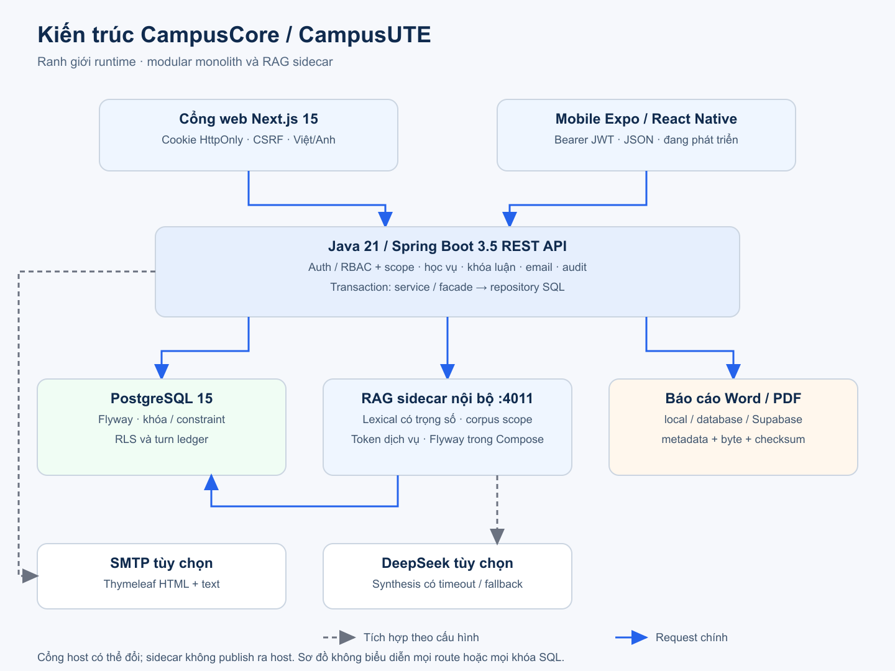

# Ảnh giao diện và GIF hiện tại

[English](media-showcase.en.md) · [Tiếng Việt](media-showcase.vi.md) · [Tài liệu kỹ thuật](technical/README.vi.md)

## Nguồn chụp

Ảnh được render thật từ build ngày 27/10/2026 theo mã nguồn hiện tại, trong project Compose `campuscore-docs` với database seed riêng. Giao diện hiển thị thương hiệu CampusUTE; tên codebase là CampusCore.

- Source: `fb9b60af3b0ad2f854047036c1cc5bb19466ead3`
- Next build: `N4g1GZ8EeONCvY1oewd5t`
- API image: `sha256:af7b5525ef900b4ecd47c55020c2186ac5747ed750015b366a184edb4bd6b661`
- Bốn role đăng nhập thật và xác minh `/api/v1/auth/me` trả 200 với email đúng.
- PNG 1440×1000; GIF rộng 1200 px, chuỗi màn hình giữ khoảng 4 giây, không phải video thao tác liên tục.
- DeepSeek và gửi SMTP bên ngoài tắt; rate limit giữ bật.

[Manifest và checksum đầy đủ](assets/showcase-2026-10/provenance.json) · [Cách tái tạo](technical/operations-verification.vi.md)

Hash trong manifest khớp cả 77 tài sản nhị phân. Hash/kích thước của hai SVG
thuộc bản gốc Windows CRLF; blob SVG được Git chuẩn hóa LF khác ở mức byte.
Khôi phục CRLF khớp hash đã ghi; đây là khác biệt xuống dòng, không phải lượt chụp mới.

## Giới hạn được quan sát

Bản seed có một metadata báo cáo nhóm trả 404 ở cả hai locale; bộ ảnh không xác nhận upload, tải hay khôi phục tài liệu. Danh sách phúc khảo và lịch sử batch CTĐT có thể trống vì chưa tạo hồ sơ. Job reconcile cảnh báo drift sĩ số seed; không tự sửa dữ liệu để chụp. Trợ lý được hỏi câu kỹ thuật trong workspace chuyên sâu, với provider ngoài tắt.

Ảnh chứng minh giao diện và các request trong manifest; không chứng minh mọi thao tác ghi, email giao thành công, RLS/race test toàn bộ, chạy mobile thật hoặc production. Một lỗi npm audit ở dependency được ghi trong manifest, không được coi là đã sửa bởi cập nhật tài liệu.

Trang email giảng viên hiện còn hiển thị placeholder `{max}` trong phần tóm tắt người nhận. Ảnh giữ nguyên lỗi copy có sẵn; cập nhật này không sửa mã giao diện.

## GIF

| Hành trình | Ảnh động |
|---|---|
| Student | [student-tour-vi.gif](assets/showcase-2026-10/student-tour-vi.gif) |
| Lecturer / Admin | [staff-tour-vi.gif](assets/showcase-2026-10/staff-tour-vi.gif) |
| Thesis governance | [thesis-governance-tour-vi.gif](assets/showcase-2026-10/thesis-governance-tour-vi.gif) |
| VI / EN | [language-tour.gif](assets/showcase-2026-10/language-tour.gif) |

## Toàn bộ màn hình

| Màn hình | Tiếng Việt | English |
|---|---|---|
| admin announcements | [PNG](assets/showcase-2026-10/admin-announcements-vi.png) | [PNG](assets/showcase-2026-10/admin-announcements-en.png) |
| admin appeals | [PNG](assets/showcase-2026-10/admin-appeals-vi.png) | [PNG](assets/showcase-2026-10/admin-appeals-en.png) |
| admin audit | [PNG](assets/showcase-2026-10/admin-audit-vi.png) | [PNG](assets/showcase-2026-10/admin-audit-en.png) |
| admin curriculum defaults | [PNG](assets/showcase-2026-10/admin-curriculum-defaults-vi.png) | [PNG](assets/showcase-2026-10/admin-curriculum-defaults-en.png) |
| admin dashboard | [PNG](assets/showcase-2026-10/admin-dashboard-vi.png) | [PNG](assets/showcase-2026-10/admin-dashboard-en.png) |
| admin knowledge | [PNG](assets/showcase-2026-10/admin-knowledge-vi.png) | [PNG](assets/showcase-2026-10/admin-knowledge-en.png) |
| admin sections | [PNG](assets/showcase-2026-10/admin-sections-vi.png) | [PNG](assets/showcase-2026-10/admin-sections-en.png) |
| admin thesis | [PNG](assets/showcase-2026-10/admin-thesis-vi.png) | [PNG](assets/showcase-2026-10/admin-thesis-en.png) |
| admin users | [PNG](assets/showcase-2026-10/admin-users-vi.png) | [PNG](assets/showcase-2026-10/admin-users-en.png) |
| dean dashboard | [PNG](assets/showcase-2026-10/dean-dashboard-vi.png) | [PNG](assets/showcase-2026-10/dean-dashboard-en.png) |
| dean thesis | [PNG](assets/showcase-2026-10/dean-thesis-vi.png) | [PNG](assets/showcase-2026-10/dean-thesis-en.png) |
| lecturer announcements | [PNG](assets/showcase-2026-10/lecturer-announcements-vi.png) | [PNG](assets/showcase-2026-10/lecturer-announcements-en.png) |
| lecturer attendance | [PNG](assets/showcase-2026-10/lecturer-attendance-vi.png) | [PNG](assets/showcase-2026-10/lecturer-attendance-en.png) |
| lecturer dashboard | [PNG](assets/showcase-2026-10/lecturer-dashboard-vi.png) | [PNG](assets/showcase-2026-10/lecturer-dashboard-en.png) |
| lecturer grades | [PNG](assets/showcase-2026-10/lecturer-grades-vi.png) | [PNG](assets/showcase-2026-10/lecturer-grades-en.png) |
| lecturer mail | [PNG](assets/showcase-2026-10/lecturer-mail-vi.png) | [PNG](assets/showcase-2026-10/lecturer-mail-en.png) |
| lecturer schedule | [PNG](assets/showcase-2026-10/lecturer-schedule-vi.png) | [PNG](assets/showcase-2026-10/lecturer-schedule-en.png) |
| lecturer thesis | [PNG](assets/showcase-2026-10/lecturer-thesis-vi.png) | [PNG](assets/showcase-2026-10/lecturer-thesis-en.png) |
| public home | [PNG](assets/showcase-2026-10/public-home-vi.png) | [PNG](assets/showcase-2026-10/public-home-en.png) |
| public login | [PNG](assets/showcase-2026-10/public-login-vi.png) | [PNG](assets/showcase-2026-10/public-login-en.png) |
| public recovery | [PNG](assets/showcase-2026-10/public-recovery-vi.png) | [PNG](assets/showcase-2026-10/public-recovery-en.png) |
| student assistant | [PNG](assets/showcase-2026-10/student-assistant-vi.png) | [PNG](assets/showcase-2026-10/student-assistant-en.png) |
| student assistant answer | [PNG](assets/showcase-2026-10/student-assistant-answer-vi.png) | [PNG](assets/showcase-2026-10/student-assistant-answer-en.png) |
| student attendance | [PNG](assets/showcase-2026-10/student-attendance-vi.png) | [PNG](assets/showcase-2026-10/student-attendance-en.png) |
| student conduct | [PNG](assets/showcase-2026-10/student-conduct-vi.png) | [PNG](assets/showcase-2026-10/student-conduct-en.png) |
| student curriculum | [PNG](assets/showcase-2026-10/student-curriculum-vi.png) | [PNG](assets/showcase-2026-10/student-curriculum-en.png) |
| student dashboard | [PNG](assets/showcase-2026-10/student-dashboard-vi.png) | [PNG](assets/showcase-2026-10/student-dashboard-en.png) |
| student enrollments | [PNG](assets/showcase-2026-10/student-enrollments-vi.png) | [PNG](assets/showcase-2026-10/student-enrollments-en.png) |
| student grades | [PNG](assets/showcase-2026-10/student-grades-vi.png) | [PNG](assets/showcase-2026-10/student-grades-en.png) |
| student notifications | [PNG](assets/showcase-2026-10/student-notifications-vi.png) | [PNG](assets/showcase-2026-10/student-notifications-en.png) |
| student registration | [PNG](assets/showcase-2026-10/student-registration-vi.png) | [PNG](assets/showcase-2026-10/student-registration-en.png) |
| student schedule | [PNG](assets/showcase-2026-10/student-schedule-vi.png) | [PNG](assets/showcase-2026-10/student-schedule-en.png) |
| student thesis | [PNG](assets/showcase-2026-10/student-thesis-vi.png) | [PNG](assets/showcase-2026-10/student-thesis-en.png) |
| student transcript | [PNG](assets/showcase-2026-10/student-transcript-vi.png) | [PNG](assets/showcase-2026-10/student-transcript-en.png) |

## Sơ đồ hiện tại

[SVG](assets/showcase-2026-10/architecture-vi.svg)
