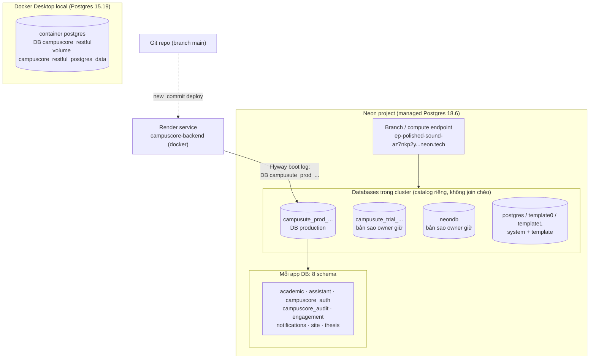

# Neon, Docker & Phân quyền CampusCore — Tài liệu học tập

> Tài liệu giải thích một lần chụp (snapshot) hệ thống ngày **2026-10-23**. Mọi con
> số đếm đều gắn nhãn giờ quan sát; đây là ảnh chụp tại một thời điểm, không phải
> trạng thái vĩnh viễn. Mã nguồn Git có thể phát triển độc lập với ảnh chụp này.

## 0. Nguồn chứng cứ và quy ước độ tin cậy

Ba mức độ tin cậy được dùng xuyên suốt tài liệu:

- **OBSERVED** — đọc trực tiếp từ catalog/runtime/provider tại giờ ghi, lưu trong
  các tệp JSON dưới [assets/](../plans/261023-1849-db-roles-and-container-production-audit/assets/).
- **SOURCE-DEFINED** — định nghĩa trong mã nguồn (compose, Dockerfile, migration,
  code Java). Nói lên ý định/hành vi được lập trình, không tự chứng minh đã chạy.
- **UNVERIFIED** — chưa có bằng chứng; nêu rõ thay vì đoán.

Bảng chứng cứ chính (giờ UTC; +07 cho giờ địa phương):

| Chứng cứ | Tệp | Giờ ghi |
| --- | --- | --- |
| Snapshot 4 CSDL Neon + roles cụm | [neon-databases-roles-schema-snapshot.json](../plans/261023-1849-db-roles-and-container-production-audit/assets/neon-databases-roles-schema-snapshot.json) | 11:53:11–11:53:23Z (~18:53 +07) |
| Snapshot CSDL local `campuscore_restful` | [local-database-schema-role-snapshot.json](../plans/261023-1849-db-roles-and-container-production-audit/assets/local-database-schema-role-snapshot.json) | 11:56:28Z (~18:56 +07) |
| Docker inspect đã lọc secret (6 container) | [docker-sanitized-runtime-snapshot.json](../plans/261023-1849-db-roles-and-container-production-audit/assets/docker-sanitized-runtime-snapshot.json) | cửa sổ ~11:47–11:57Z (~18:51 +07) |
| So sánh cấu trúc + digest dữ liệu local↔prod | [local-versus-production-database-comparison.json](../plans/261023-1849-db-roles-and-container-production-audit/assets/local-versus-production-database-comparison.json) | phiên đọc riêng từng bên |
| Phân loại khác biệt schema (offline) | [classified-schema-differences.json](../plans/261023-1849-db-roles-and-container-production-audit/assets/classified-schema-differences.json) | phân tích trên tệp so sánh |
| Health/build public local↔prod | [local-versus-production-public-build-health.json](../plans/261023-1849-db-roles-and-container-production-audit/assets/local-versus-production-public-build-health.json) | ~11:57Z (~18:57 +07) |
| Render live evidence + Flyway boot logs (deploy `743eea38` trước đó) | [render-production-live-evidence.json](../plans/261023-1849-db-roles-and-container-production-audit/assets/render-production-live-evidence.json) | deploy live 10:19Z; logs boot 04:28–10:19Z |
| Render recheck deploy mới nhất | [render-current-deploy-recheck.json](../plans/261023-1849-db-roles-and-container-production-audit/assets/render-current-deploy-recheck.json) | deploy `18ad15ff` live 12:02:59Z |
| Render post-deploy DB binding (deploy đang live) | [render-postdeploy-db-binding.json](../plans/261023-1849-db-roles-and-container-production-audit/assets/render-postdeploy-db-binding.json) | recheck 14:31Z; instance boot 12:00:02Z, Flyway→DB 12:01:24Z, live 12:02:59Z |
| Public observation cuối | [production-public-observation-final.json](../plans/261023-1849-db-roles-and-container-production-audit/assets/production-public-observation-final.json) | 13:46:45Z (20:46 +07) |

**Giới hạn môi trường lúc viết (20:46 +07):** Docker daemon không khả dụng ở lần
theo dõi 20:46 — các trạng thái container "healthy" chỉ là snapshot ~18:51 và
readiness local 18:57, **không** phải trạng thái hiện tại. Frontend/API production
public đã recheck HTTP 200 lúc 20:46 +07 — chỉ chứng minh endpoint trả lời được,
không chứng minh login, luồng nghiệp vụ hay cấu hình provider. Env hiệu lực của
production chưa đọc được (`environmentVariableReaderAvailable: false`); readiness
production là `NOT_RUN` vì thiếu credential đã lưu. Git source có thể đã tiến xa
hơn snapshot.

---

## 1. Hệ thống Neon: database chính, các bản sao và cấp phân cấp

### 1.1. Database chính (production) là gì, chứng minh thế nào?

Render service `campuscore-backend` (workspace `NguyenSonProjects`, runtime docker,
region singapore, branch `main`) **đang chạy deploy `18ad15ff`**
(`dep-dbdknpdg1s2s73dpg0a0`, live 12:02:59Z — deploy mới nhất tại lần recheck
provider 14:31Z). Biên bản
[render-postdeploy-db-binding.json](../plans/261023-1849-db-roles-and-container-production-audit/assets/render-postdeploy-db-binding.json)
ghi đúng cửa sổ deploy này: instance mới `srv-dadt439t0dsc73fvie2g-6w625` boot
12:00:02Z → Flyway kết nối host
`ep-polished-sound-az7nkp2y.c-3.ap-southeast-1.aws.neon.tech`, database
**`campusute_prod_20261015t060105z`** (PostgreSQL 18.6) lúc 12:01:24Z → app ready
12:02:50Z → deploy live 12:02:59Z.

Cùng host+database đó cũng xuất hiện trong boot log của deploy trước `743eea38`
(04:28, 06:04, 09:13, 10:18Z, mỗi lần kèm `assistantRls: verified` —
[render-production-live-evidence.json](../plans/261023-1849-db-roles-and-container-production-audit/assets/render-production-live-evidence.json)).
Đây là bằng chứng OBSERVED cấp provider: **tại recheck 14:31Z, deploy đang live
đã bind lúc boot tới `campusute_prod_20261015t060105z`** trên cụm Neon đó. Giới
hạn của chứng cứ: chỉ chứng minh DB binding *khi khởi động* của deployment này —
env hiệu lực đầy đủ chưa đọc được (`environmentVariableReaderAvailable: false`),
mọi thay đổi cấu hình runtime sau đó hay deploy tương lai cần quan sát lại; không
suy ra trạng thái vĩnh viễn hay tương đương code/image với local (mục 5–6).

### 1.2. Toàn bộ database trên cụm Neon (OBSERVED 11:53Z)

`pg_database` trên cluster liệt kê 6 database:

| Database | Template? | Cho phép kết nối | Owner | Vai trò |
| --- | --- | --- | --- | --- |
| `campusute_prod_20261015t060105z` | không | có | `neondb_owner` | **DB production đang dùng** (boot log của deploy live 12:02:59Z, mục 1.1) |
| `campusute_trial_20261015t014700z` | không | có | `neondb_owner` | Bản sao trial do owner giữ; dữ liệu lệch prod |
| `neondb` | không | có | `neondb_owner` | DB mặc định Neon tạo sẵn; cũng chứa schema app |
| `postgres` | không | có | `cloud_admin` | DB quản trị/provider (schema `neon.*` internal, `public.health_check`, `neon_migration`) |
| `template0` | có | không | `cloud_admin` | Template gốc, không connect trực tiếp |
| `template1` | có | có | `cloud_admin` | Template mặc định cho `CREATE DATABASE` |

Điểm quan trọng: `trial` và `neondb` nên được hiểu là **các dataset độc lập do
owner giữ** — cùng hình dạng schema V134 như prod nhưng dữ liệu khác (ví dụ
`Enrollment` 3914 trên prod vs 3903 trên trial và neondb; `Student` 232 vs 230;
`Session` 422 vs 189 vs 157). Trong chứng cứ thu thập được **không quan sát thấy
cơ chế replication tự động hay failover** giữa chúng với prod — không có gì cho
thấy đồng bộ liên tục. Đây là phát biểu phạm vi chứng cứ ("chưa thấy trong
snapshot"), không phải chứng minh tuyệt đối rằng không tồn tại cơ chế nào.
Mỗi DB là một catalog riêng; câu hỏi "dữ liệu giống nhau không" chỉ trả lời được
bằng đếm/so sánh tại thời điểm snapshot.

### 1.3. Phân cấp Neon so với Git branch và Docker local



- **Neon project** là đơn vị tổ chức cao nhất; **branch** trong Neon là một
  endpoint tính toán kèm tập dữ liệu — theo [tài liệu nền tảng Neon](https://neon.com/docs/introduction/branching),
  branch dùng cơ chế copy-on-write (đây là hành vi được Neon công bố, *khái niệm nền tảng*,
  không phải thứ audit này quan sát trực tiếp trong runtime) — *khác hẳn*
  **Git branch** (nhánh mã nguồn). Git branch `main` là thứ Render theo dõi để
  build/deploy; hai khái niệm "branch" trùng tên nhưng không liên quan.
- **Database** là catalog độc lập trong cluster; **schema** là namespace bên trong
  database nhóm các **table/view**. Không join được chéo database trong một
  connection — phải chọn đúng DB trước (xem mục 7).
- **Docker local** là container PostgreSQL riêng trên máy (image
  `student-management-ute-database:local`, base `postgres:15-alpine`,
  [database/Dockerfile](../database/Dockerfile)), DB `campuscore_restful`, dữ
  liệu nằm trong named volume — tồn tại độc lập với image và code.

### 1.4. Kích thước schema tại snapshot

| Môi trường | Engine | Bảng gốc (BASE TABLE) | View | Migration mới nhất |
| --- | --- | --- | --- | --- |
| `campusute_prod_...` (Neon) | PostgreSQL 18.6 | 71 | 2 (`campuscore_auth.Student`, `.Lecturer`) | V134, success |
| `campusute_trial_...` (Neon) | PostgreSQL 18.6 | 71 | 2 | V134, success |
| `neondb` (Neon) | PostgreSQL 18.6 | 71 | 2 | V134, success |
| `campuscore_restful` (local Docker) | PostgreSQL 15.19 | 70 | 2 | V134, success |

Chênh 71↔70 đến từ `academic."User"` — bảng legacy chỉ còn trên Neon (0 dòng),
không có trên local (mục 2 và 5). Lưu ý: cây source hiện chứa file migration tới
[V135__purge_verification_probe_notifications.sql](../java-services/restful-api/src/main/resources/db/migration/V135__purge_verification_probe_notifications.sql),
tức repo đi trước trạng thái đã apply — minh họa đúng nguyên tắc "source Git
tiến độc lập với snapshot".

---

## 2. Tám schema ứng dụng và vai trò từng bảng/view

Cùng 8 schema xuất hiện trong cả 3 app DB trên Neon và local (danh sách schema
khớp `SCHEMAS` trong [compare-local-and-production.py](../plans/261023-1849-db-roles-and-container-production-audit/assets/compare-local-and-production.py)).
Số dòng dưới đây là của `campusute_prod_...` lúc 11:53Z; local/trial/neondb lệch
từng chỗ — chỉ dùng để định hướng học, không phải bảng kiểm đối chiếu.

### 2.1. `academic` — lõi học vụ (28 bảng trên Neon, 27 trên local)

| Quan hệ | Mục đích ngắn |
| --- | --- |
| `AcademicYear` | Năm học |
| `Attendance` | Điểm danh buổi/lớp học |
| `Classroom` | Phòng học vật lý |
| `Course` | Học phần trong danh mục môn |
| `CourseRequirement` | Quan hệ tiên quyết/song hành giữa học phần |
| `CreditLimitApplication` | Đơn xin vượt hạn mức tín chỉ |
| `Curriculum` | Khung chương trình đào tạo |
| `CurriculumCourse` | Học phần xếp vào khung theo năm/học kỳ |
| `Department` | Bộ môn (thuộc `Faculty`) — gốc scope trưởng bộ môn |
| `Enrollment` | Đăng ký học phần của sinh viên |
| `EnrollmentEvent` | Vết sự kiện vòng đời đăng ký |
| `Faculty` | Khoa — gốc scope trưởng khoa |
| `GradeItem` | Đầu điểm thành phần của lớp |
| `GradeItemLegacyArchive` | Kho lưu trữ đầu điểm đời cũ |
| `Lecturer` | Hồ sơ giảng viên — **bảng gốc** của view `campuscore_auth."Lecturer"` |
| `RegistrationIdempotency` | Khóa idempotency chống request đăng ký lặp |
| `RegistrationRound` | Đợt đăng ký học phần |
| `RegistrationRoundCohort` | Giới hạn đợt theo nhóm/khóa (0 dòng ở mọi snapshot — có thể cố ý chờ cấu hình) |
| `RegistrationSlip` | Phiếu đăng ký đã xuất |
| `Section` | Lớp học phần mở trong học kỳ |
| `SectionSchedule` | Lịch học (thứ/tiết/phòng) của lớp |
| `Semester` | Học kỳ |
| `Student` | Hồ sơ sinh viên — **bảng gốc** của view `campuscore_auth."Student"` |
| `StudentGrade` | Điểm số sinh viên theo đầu điểm |
| `StudentGradeLegacyArchive` | Kho lưu trữ điểm đời cũ |
| `User` | **Bảng legacy 0 dòng, chỉ còn trên 3 DB Neon** — login thực tế không dùng bảng này (mục 3) |
| `conduct_activity` | Hoạt động rèn luyện |
| `conduct_semester_score` | Điểm rèn luyện tổng hợp học kỳ |

### 2.2. `assistant` — trợ lý AI/RAG (13 bảng)

| Quan hệ | Mục đích ngắn |
| --- | --- |
| `chat_citation` | Trích dẫn tài liệu gắn vào câu trả lời |
| `chat_conversation` | Cuộc hội thoại |
| `chat_message` | Tin nhắn trong hội thoại |
| `chat_message_feedback` | Feedback tin nhắn (0 dòng trên Neon; local có 20 — có thể chỉ là chưa dùng) |
| `chat_turn_ledger` | Sổ cái lượt xử lý + chống vượt quota |
| `knowledge_document` | Tài liệu tri thức gốc |
| `knowledge_document_audit` | Vết kiểm toán tài liệu |
| `knowledge_document_revision` | Phiên bản soạn thảo (workflow duyệt 2 admin) |
| `knowledge_release` | Bản phát hành tri thức xuất cho runtime |
| `knowledge_runtime_document` | Tài liệu đã chiếu sang snapshot runtime phục vụ truy hồi |
| `knowledge_runtime_state` | Con trỏ trạng thái runtime hiện hành (1 dòng) |
| `provider_dispatch_registry` | Nhật ký điều phối sang provider LLM |
| `usage_bucket` | Bucket hạn ngạch sử dụng/ngày |

### 2.3. `campuscore_auth` — định danh & RBAC (8 bảng + 2 view)

| Quan hệ | Mục đích ngắn |
| --- | --- |
| `"User"` (272 prod / 270 local) | **Bảng đăng nhập thật** — email, hash mật khẩu, trạng thái, cờ `isSuperAdmin`, `credentialVersion` |
| `"Role"` (6) | Vai trò ứng dụng — mục 3 |
| `"UserRole"` (274 prod / 272 local) | Gán vai trò cho user (bảng nối M:N) |
| `"Permission"` (2) | Quyền nguyên tử dạng `module:action` |
| `"RolePermission"` (2) | Liên kết Role↔Permission (cả 2 thuộc STUDENT) |
| `"Session"` (422 prod / 158 local) | Phiên refresh-token còn hạn — khác nhau là bình thường vì mỗi môi trường có người đăng nhập riêng |
| `"PasswordResetToken"` (0 mọi nơi) | Token reset mật khẩu — rỗng có thể cố ý/chưa dùng |
| `"TwoFactorChallenge"` (0 mọi nơi) | Thử thách OTP email — rỗng có thể cố ý/chưa dùng |
| `"Student"` (view) | `SELECT id,"userId","studentId","curriculumId",year,status,"admissionDate","createdAt","updatedAt" FROM academic."Student"` |
| `"Lecturer"` (view) | `SELECT id,"userId","departmentId","employeeId","isActive" FROM academic."Lecturer"` |

Hai view này là **lớp tương thích đọc**: code auth join `campuscore_auth."Student"`
nhưng dữ liệu thật nằm ở `academic."Student"`/`academic."Lecturer"` (định nghĩa
view lấy nguyên văn từ `pg_views` trong snapshot). Bảng rỗng không đồng nghĩa lỗi —
reset/OTP/feedback/cohort restriction là bảng *được dùng khi có luồng tương ứng*;
local `MAIL_ENABLED=false` nên các bảng mail phụ không có dòng là hợp lý.

Quan sát nhỏ tại snapshot local: số gán role `STUDENT` trong
`campuscore_auth."UserRole"` là **230**, trong khi bảng vật lý
`academic."Student"` có **229** dòng — lệch đúng 1 giữa "tài khoản mang role
STUDENT" và "hồ sơ sinh viên tồn tại". Audit chỉ ghi nhận chênh lệch này tại
thời điểm snapshot; không xác định tài khoản nào lệch hay nguyên nhân (xóa hồ
sơ, gán role thủ công, hay dữ liệu seed đều chỉ là khả năng chưa kiểm chứng).

### 2.4. Các schema còn lại

| Schema | Quan hệ | Mục đích ngắn |
| --- | --- | --- |
| `campuscore_audit` | `AdminAudit` | Nhật ký hành động quản trị (ai làm gì lên tài khoản) |
| `engagement` | `Announcement` | Thông báo cổng hiển thị tới người dùng |
| `engagement` | `AnnouncementAudit` | Vết kiểm toán thay đổi thông báo |
| `engagement` | `AnnouncementTagMap` | Gán tag phân loại cho thông báo |
| `engagement` | `ArticleAttachment` | File đính kèm của bài viết |
| `engagement` | `ArticleCategory` | Danh mục phân loại bài viết |
| `engagement` | `ArticleMediaGallery` | Bộ sưu tập media gắn bài viết |
| `engagement` | `ArticleReadingMetric` | Metric lượt đọc bài viết |
| `engagement` | `ArticleTag` | Tag gắn bài viết |
| `notifications` | `notification` | Thông báo trong hệ thống gửi tới user |
| `site` | `Appearance` | Cấu hình giao diện public site (1 dòng) |
| `thesis` | `flyway_schema_history` | Lịch sử migration Flyway — đặt trong schema `thesis` |
| `thesis` | `thesis_registration_round` | Đợt đăng ký khóa luận |
| `thesis` | `thesis_topic` | Đề tài khóa luận |
| `thesis` | `thesis_topic_supervisor` | Giảng viên hướng dẫn của đề tài |
| `thesis` | `thesis_topic_score` | Điểm đề tài |
| `thesis` | `thesis_group` | Nhóm khóa luận của sinh viên |
| `thesis` | `thesis_group_member` | Thành viên trong nhóm khóa luận |
| `thesis` | `thesis_group_report` | Báo cáo/file nhóm nộp (metadata; nơi lưu bytes tùy provider cấu hình) |
| `thesis` | `thesis_council` | Hội đồng bảo vệ khóa luận |
| `thesis` | `thesis_council_member` | Ghế thành viên hội đồng (CHAIR/SECRETARY/MEMBER — dữ liệu nghiệp vụ, không phải role) |
| `thesis` | `thesis_council_topic` | Đề tài được gán vào hội đồng |

---

## 3. Sáu vai trò ứng dụng và mô hình phân quyền M:N

### 3.1. Bảng đếm vai trò (OBSERVED snapshot 11:53Z Neon / 11:56Z local)

| Role | prod | trial | neondb | local | Mô tả trong DB |
| --- | --- | --- | --- | --- | --- |
| `STUDENT` | 232 | 230 | 230 | 230 | Course demo student role |
| `LECTURER` | 37 | 37 | 37 | 37 | Course demo lecturer role |
| `ADMIN` | 2 | 2 | 2 | 2 | Course demo administrator role |
| `SUPER_ADMIN` | 1 | 1 | 1 | 1 | Super administrator: unrestricted governance across modules (bản local ghi "E2E test role (local)") |
| `TRUONG_KHOA` | 1 | 1 | 1 | 1 | Faculty head: owns thesis rounds, councils and result publication |
| `TRUONG_BO_MON` | 1 | 1 | 1 | 1 | Trưởng bộ môn (department head): thesis governance scoped to own department |
| **Tổng gán (UserRole)** | **274** | **272** | **272** | **272** | |
| **Tổng user** | **272** | **270** | **270** | **270** | |

Tổng gán **vượt** tổng user ở mọi DB vì đúng 2 tài khoản mang **cặp đôi** vai trò:
combination list cho thấy `LECTURER,TRUONG_BO_MON` (1) và `LECTURER,TRUONG_KHOA`
(1) — còn lại mỗi user một vai trò (`LECTURER` 35, `STUDENT` 230–232, `ADMIN` 2,
`SUPER_ADMIN` 1). Trạng thái tài khoản: prod ACTIVE 24 / LOCKED 248 (1 superadmin),
trial & neondb ACTIVE 20 / LOCKED 250, local ACTIVE 34 / LOCKED 236.

### 3.2. Chuỗi M:N và vì sao "2 Permission" không nghĩa là "ADMIN không có quyền"

```
campuscore_auth."User" ──< "UserRole" >── "Role" ──< "RolePermission" >── "Permission"
```

Chỉ có 2 dòng `Permission` (`academic:read`, `thesis:read`) và 2 dòng
`RolePermission` — cả hai gắn vào `STUDENT`. Đây **không phải** toàn bộ mô hình
quyền: phần lớn kiểm soát truy cập nằm trong **role claim trên JWT + kiểm tra
code**, không nằm trong bảng Permission. Luồng thực tế:

1. `AuthUserRepository.findRoles` đọc role qua join `UserRole`→`Role`
   ([AuthUserRepository.java](../java-services/restful-api/src/main/java/io/campuscore/restfulapi/auth/repository/AuthUserRepository.java)):

```java
private List<String> findRoles(String userId) {
    return jdbc.queryForList(
            "SELECT r.\"name\""
                    + " FROM " + USER_ROLE_TABLE + " ur"
                    + " INNER JOIN " + ROLE_TABLE + " r ON r.\"id\" = ur.\"roleId\""
                    + " WHERE ur.\"userId\" = :userId"
                    + " ORDER BY r.\"name\"",
            new MapSqlParameterSource("userId", userId), String.class);
}
```

2. `findPermissions` (cùng file) join tiếp `RolePermission`→`Permission` thành
   chuỗi `module:action`; `findAccountAuthorization` gộp cả hai thành snapshot
   quyền một lần đọc.
3. `AuthLoginService.principal` đóng gói roles+permissions vào `AuthPrincipal`
   ([AuthLoginService.java](../java-services/restful-api/src/main/java/io/campuscore/restfulapi/auth/service/AuthLoginService.java)), rồi
   `AuthTokenService.issueAccessToken` ghi thẳng vào JWT claims
   ([AuthTokenService.java](../java-services/restful-api/src/main/java/io/campuscore/restfulapi/security/AuthTokenService.java)):

```java
JwtClaimsSet.Builder claims = JwtClaimsSet.builder()
        .issuer("campuscore-restful-api")
        .issuedAt(issuedAt)
        .expiresAt(expiresAt)
        .subject(principal.id())
        .claim("email", principal.email())
        .claim("tokenType", "access")
        .claim("roles", roles)
        .claim("permissions", permissions)
        .claim("credentialVersion", principal.credentialVersion());
```

4. `SecurityConfig` ([SecurityConfig.java](../java-services/restful-api/src/main/java/io/campuscore/restfulapi/security/SecurityConfig.java)) từ chối
   bearer không phải `tokenType=access` hoặc thiếu claim `roles`, rồi biến claims
   thành authority `ROLE_<tên>` / `PERM_<module:action>`:

```java
static Collection<GrantedAuthority> authoritiesFromClaims(Jwt jwt) {
    List<GrantedAuthority> authorities = new ArrayList<>();
    addAuthorities(authorities, jwt.getClaims().get("roles"), "ROLE_");
    addAuthorities(authorities, jwt.getClaims().get("permissions"), "PERM_");
    return authorities;
}
```

5. Kiểm tra thực thi là `@PreAuthorize("hasAnyRole('ADMIN','TRUONG_KHOA',...)")`
   trên controller + rule URL (`POST/PUT/PATCH/DELETE /api/v1/users/**`,
   `/api/v1/admin/**` → `hasAnyRole("ADMIN","SUPER_ADMIN")`) + scope nghiệp vụ
   trong service. Vì vậy ADMIN không cần dòng Permission nào vẫn có quyền —
   quyền đến từ role, không từ bảng Permission.

### 3.3. Trưởng khoa / trưởng bộ môn là cặp "chức danh + giảng viên"

`TRUONG_KHOA` (trưởng khoa) và `TRUONG_BO_MON` (trưởng bộ môn) **không đứng một
mình**: migration [V89__role_hygiene_faculty_head_separation.sql](../java-services/restful-api/src/main/resources/db/migration/V89__role_hygiene_faculty_head_separation.sql)
và [V120__seed_truong_bo_mon_role.sql](../java-services/restful-api/src/main/resources/db/migration/V120__seed_truong_bo_mon_role.sql)
định nghĩa chúng là chức danh gắn trên tài khoản LECTURER. Phạm vi không nằm
trong role mà resolve động từ hồ sơ giảng viên của chính JWT subject —
[ThesisDepartmentScope.java](../java-services/restful-api/src/main/java/io/campuscore/restfulapi/thesis/service/ThesisDepartmentScope.java)
kiểm tra claim `roles` chứa `TRUONG_BO_MON` rồi lấy `departmentId` từ
`campuscore_auth."Lecturer"` join `academic."Department"` có `isActive`;
[ThesisDeanScope.java](../java-services/restful-api/src/main/java/io/campuscore/restfulapi/thesis/service/ThesisDeanScope.java)
tương tự cho khoa qua `Department.facultyId`. Mất hồ sơ lecturer active = mất
scope.

Ghế hội đồng (`CHAIR`/`SECRETARY`/`MEMBER` trong `thesis_council_member`) và các
vị trí nhóm nghiệp vụ khác là **dữ liệu nghiệp vụ**, không phải role toàn cục
trong `campuscore_auth."Role"` — đừng tra role cho chúng; kiểm chính tả trong DB
là `TRUONG_KHOA`/`TRUONG_BO_MON`.

### 3.4. SUPER_ADMIN: role và cờ `isSuperAdmin`

Snapshot `superAdminFlagRoleConsistency` cho thấy đúng 1 tài khoản có
`isSuperAdmin=true` VÀ giữ role `SUPER_ADMIN` — nhất quán ở mọi DB. Nhưng quyết
định ủy quyền đi qua **role join**, không phải cờ:
[AdminUserMutationController.java](../java-services/restful-api/src/main/java/io/campuscore/restfulapi/auth/web/AdminUserMutationController.java)
`isSuperAdmin` chỉ kiểm tra authority `ROLE_SUPER_ADMIN` (tức claim JWT ←
`UserRole`→`Role`). Cờ DB là dữ liệu phụ; cờ đúng mà thiếu dòng `UserRole` thì
không có quyền. Ngược chiều,
[AdminUserMutationService.java](../java-services/restful-api/src/main/java/io/campuscore/restfulapi/auth/service/AdminUserMutationService.java)
giữ hai lớp
trần: `SUPER_ADMIN_ONLY_ROLES = ADMIN, SUPER_ADMIN, TRUONG_KHOA, TRUONG_BO_MON`
(admin thường không được cấp/gỡ/sửa-tài-khoản-mang những role này) và
`guardRoleMutation`/`requireSuperAdminForProtectedAccount` chặn leo thang qua cả
đường account thay vì role.

### 3.5. Role PostgreSQL server ≠ role nghiệp vụ

`pg_roles` trên cụm (OBSERVED) là **tài khoản đăng nhập cấp server**, chia sẻ cho
mọi DB trong cluster:

| Role PG | login | super | bypassRLS | connlimit | Vai trò |
| --- | --- | --- | --- | --- | --- |
| `campuscore_assistant_runtime` | có | không | không | 8 | Login chuyên cho luồng assistant/RAG; RLS policies `assistant.*` gắn role này; provision bởi [V84__assistant_rls_runtime_policies.sql](../java-services/restful-api/src/main/resources/db/migration/V84__assistant_rls_runtime_policies.sql) + provisioner container |
| `neondb_owner` | có | không | có | −1 | Owner 3 app DB — tài khoản quản lý Neon |
| `cloud_admin` | có | có | có | −1 | Quản trị nội bộ Neon (owner `postgres`/templates) |
| `neon_service` | có | không | có | −1 | Service nội bộ Neon |
| `neon_superuser` | không | không | có | −1 | Role nội bộ Neon (NOLOGIN) |

Role nghiệp vụ (`STUDENT`, `ADMIN`, …) là **dữ liệu** trong bảng
`campuscore_auth."Role"` của từng DB — hai tầng hoàn toàn khác nhau: một cái quyết
định "ai được connect/chịu RLS", một cái quyết định "được gọi API nào".

---

## 4. Sáu service trong cụm Docker local (snapshot ~18:51 +07)

Ảnh inspect OBSERVED `student_management` project trong
`docker-sanitized-runtime-snapshot.json` (định nghĩa: [docker-compose.yml](../docker-compose.yml)):

| Service | Image / build | Cổng host→container | Mount | Trạng thái lúc snapshot | Điểm cần hiểu |
| --- | --- | --- | --- | --- | --- |
| `web` | `student-management-ute-frontend:local` | `127.0.0.1:3100→3000` | — | running/healthy | Next.js portal; `NODE_ENV=production` = **chế độ build/chạy production của Node**, không phải "môi trường production thật"; proxy `/api/v1` → `JAVA_API_ORIGIN=http://restful-api:4010` ([route.ts](<../frontend/src/app/api/v1/[...path]/route.ts>)) |
| `restful-api` | `student-management-ute-restful-api:local` | `127.0.0.1:4010→4010` | volume `campuscore_thesis_report_storage` → `/var/lib/campuscore/thesis-reports` | running/healthy | Spring Boot API; `SPRING_DATASOURCE_URL` trỏ `postgres:5432/campuscore_restful` **trong mạng compose** (tên service, không phải 127.0.0.1); `FLYWAY_ENABLED=false` vì rag-service giữ vai trò migrate |
| `rag-service` | `student-management-ute-rag-service:local` (cùng Dockerfile) | chỉ `expose` 4011 nội bộ, không publish | — | running/healthy | Sidecar cùng JAR; `FLYWAY_ENABLED=true` = bên chạy migration; `DEEPSEEK_ENABLED=true`; `ASSISTANT_RAG_SERVICE_MODE=true` |
| `postgres` | `student-management-ute-database:local` (PG 15.19) | `127.0.0.1:5435→5432` | volume `campuscore_restful_postgres_data` → `/var/lib/postgresql/data` | running/healthy | DB local `campuscore_restful`, user `campuscore`; port host dời sang 5435 nên tool bên ngoài dùng `127.0.0.1:5435` |
| `mailpit` | `axllent/mailpit:v1.21` | `127.0.0.1:1026→1025` (SMTP), `127.0.0.1:8026→8025` (UI) | — | running/healthy | Bắt thư SMTP dev; **mail thật tắt** — `MAIL_ENABLED=false` trên api dù Mailpit healthy: mail là opt-in, health của Mailpit không bắt buộc app dùng nó |
| `assistant-db-provisioner` | `node:20-alpine` | — | bind script `provision-assistant-runtime.mjs` (ro) | **Exited(0)** | Job một-lần cấp password cho `campuscore_assistant_runtime`; `Exited 0` = chạy xong thành công, **không phải lỗi** — `restart:"no"` |

Nhận xét cốt lõi:

- **Cổng host ≠ cổng nội bộ**: API/RAG nói chuyện `postgres:5432` và
  `rag-service:4011` theo DNS compose; host Windows chỉ thấy 3100/4010/5435/
  1026/8026 trên `127.0.0.1`.
- **`NODE_ENV=production` trên web** chỉ là chế độ build Next.js trong container
  local — đừng suy ra "đây là production".
- **Volume tồn tại độc lập image/code**: `campuscore_restful_postgres_data` giữ
  dữ liệu DB; `campuscore_thesis_report_storage` giữ file báo cáo local
  (`THESIS_REPORT_STORAGE_PROVIDER=local`). [render.yaml](../render.yaml) khai
  `THESIS_REPORT_STORAGE_PROVIDER: "database"` cho service `campuscore-backend`
  — đó là ý định SOURCE-DEFINED trong recipe; env hiệu lực production chưa đọc
  được nên **không khẳng định** provider thật đang chạy. Đừng suy flag prod từ
  recipe.
- Nhắc lại: trạng thái này là snapshot ~18:51; daemon không khả dụng lúc 20:46
  nên không coi container "đang healthy".

---

## 5. Đối chiếu local ↔ production theo 6 trục

| Trục | Kết quả snapshot | Chi tiết |
| --- | --- | --- |
| Code/JAR | API và RAG local dùng **cùng một JAR** (sha256 `b43c5f63…f372` — chứng cứ controller thu thập trong cửa sổ inspect; hai image ID khác nhau vẫn chứa JAR giống hệt vì cùng build [java-services/restful-api/Dockerfile](../java-services/restful-api/Dockerfile), `imageCreated` trùng 06:10:38Z) | Không có label `org.opencontainers.image.revision` ⇒ **không chứng minh được** local image khớp đúng commit backend nào |
| Build frontend | local `JWPGQNFutRc5-a_ikRtYs` (18:57); prod `LVXhn8n3bf1T3p0u87TBZ` (recheck 20:46; sớm hơn là `74pp4YZjCgvXIK3oDUOt6` ~18:57) | buildId khác **một mình không chứng minh** source/hành vi khác — chỉ chứng minh hai artifact build khác nhau |
| Deploy prod | `743eea38` live 10:19Z → **đã bị thay bởi** `18ad15ff` live 12:02:59Z; deploy mới cũng có boot-log DB binding 12:01:24Z (mục 1.1) | commit Git mới nhất, không phải nhãn image local |
| Migration | Cả hai bên: 131 entry SQL, mới nhất V134 success; **chỉ khác checksum V102**: local `NULL` vs prod `-1324596206` | Không kết luận được lần chạy gốc của V102 — bản ghi local thiếu checksum |
| Schema | 10 cột chỉ-prod (7 `academic."User"` legacy + `reviewed_by`/`reviewed_at`/`published_at` trên `assistant.knowledge_release`); 3 constraint chỉ-prod thật (`User_pkey`, `User_email_key`, `thesis.thesis_council_member_lecturer_fk` — FK cuối **thiếu trên local**) | Đây là drift thật, không phải nhiễu định dạng |
| Constraint tổng | 247 local vs 778 prod | Trong 778 có **528 hàng `pg_constraint` loại `n`** = cách PG18 ghi NOT NULL vào catalog; 7 trong số đó nằm trên `academic."User"` (bảng thiếu local). Local (PG15) lưu NOT NULL trong `pg_attribute` nên **không mất bảo vệ** — chỉ khác cách catalog biểu diễn. Thêm 14 cặp CHECK chỉ khác render deparser (`'x'::character varying` trong `::text[]` vs `('x')::text` phần tử) |
| RLS | 59 policies mỗi bên; **4 cặp khác render deparser** | Classifier chỉ chứng minh "cùng mảng literal render khác cách" — phân loại bảo thủ, **không** phải bằng chứng tương đương bảo mật |
| Dữ liệu | 11/71 bảng có aggregate digest bằng nhau; 39 bảng khác số dòng; 20 bảng cùng số dòng khác digest; `academic."User"` chỉ có ở prod | So sánh trên hai engine khác nhau (15.19↔18.6), `to_jsonb` đổi theo cột — đây là bằng chứng tổng hợp thời điểm quan sát, **không** phải chứng minh ngữ nghĩa 100% |
| Config/env | Local: `FLYWAY_ENABLED=false` (api), `MAIL_ENABLED=false`, `COOKIE_SECURE=false`, `DEMO_ACCOUNTS_ENABLED=true`, quota 20/200 | Prod: `environmentVariableReaderAvailable=false` ⇒ env hiệu lực **UNVERIFIED**; `render.yaml` là ý định, không phải trạng thái chạy |
| Topology | Local: 6 container compose trên Docker Desktop | Prod OBSERVED: Render docker service `campuscore-backend` → Neon `campusute_prod_...`; frontend public `www.campusute.io.vn`. [docker-compose.prod.yml](../docker-compose.prod.yml) (Caddy + Supabase + `ops/secrets`) là recipe self-host tổng quát — **không** phải topology Render/Vercel/Neon đã quan sát; mention Supabase trong đó không chứng minh provider DB hiện tại |

Kết luận trục: chứng cứ chỉ chứng minh **hai container Java local chia sẻ cùng
một JAR**; giữa local và prod **chưa** có bằng chứng image/code trùng nhau vì
image local thiếu nhãn revision và image prod không nằm trong tầm kiểm chứng.
**Schema/dữ liệu/config/topology khác có chủ đích và có drift thật** — bảng trên
nói đúng phần nào bằng chứng cho phép khẳng định và phần nào chỉ dừng ở OBSERVED
hay UNVERIFIED.

---

## 6. Định danh build — cái gì chứng minh được, cái gì không

- **JAR giống hệt trong hai image khác nhau là bình thường**: image ID là hash
  toàn bộ layer; `restful-api` và `rag-service` cùng build một Dockerfile nên
  `app.jar` giống nhau dù image ID khác. Ngược lại cũng đúng — nên **image ID
  khác nhau không chứng minh code khác**.
- **Không có nhãn revision Git** trên image local (`imageRevision: null` trên cả
  6) ⇒ không ánh xạ container → commit chính xác. Muốn chứng minh commit, cần
  label `org.opencontainers.image.revision` khi build — hiện chưa có
  (SOURCE-DEFINED: `java-services/restful-api/Dockerfile` không ghi label đó).
- **Frontend buildId** là nhãn artifact build của Next.js; `LVXhn8n3bf1T3p0u87TBZ`
  (prod 20:46) ≠ `JWPGQNFutRc5-a_ikRtYs` (local 18:57) chỉ nói hai lần build khác
  nhau — cùng source vẫn sinh buildId khác nhau, nên **không suy ra source hay
  hành vi khác** chỉ từ buildId.
- **Image là snapshot build, env quyết định hành vi, volume quyết định dữ liệu**:
  cùng image + env khác = hành vi khác; cùng image + volume khác = dữ liệu khác.
  Ba thứ này phải so tách rời — đó là lý do parity table mục 5 chia trục.
- **Không khẳng định** có/không có RAG service ở nơi khác ngoài chứng cứ đã thấy
  (compose local + `docker-compose.prod.yml` recipe); Render chỉ OBSERVED một
  web service `campuscore-backend` — topology phụ khác là UNVERIFIED.

---

## 7. Bài tập SQL chỉ-đọc (READONLY) trên Neon

Luật an toàn: chỉ `SELECT`/`SHOW`; **không** `UPDATE/ALTER/DROP/CREATE`, không
lệnh "repair"; mỗi connection chỉ vào được **một** database — trong Neon SQL
Editor chọn đúng DB ở dropdown trước khi chạy; không có join chéo database.
Tên bảng camelCase phải đặt trong ngoặc kép đúng hoa-thường (`"User"` khác
`"user"`; không ngoặc kép thì Postgres gập về lowercase). Các bài tập dưới đây
chỉ liệt kê metadata hoặc đếm tổng hợp — **không select cột định danh cá nhân**
(`email`, `studentId`, `phone`, tên, địa chỉ…) vì không cần thiết để học phân
quyền và tránh lôi dữ liệu riêng tư ra màn hình.

```sql
-- 0) Bạn đang ở đâu? (chạy sau khi chọn DB trong dropdown)
SELECT current_database(), current_schema(), current_setting('server_version');
-- kỳ vọng trên prod DB: campusute_prod_20261015t060105z · public · 18.6 ...

-- 1) Liệt kê schema và bảng/view của app
SELECT table_schema, table_name, table_type
FROM information_schema.tables
WHERE table_schema = ANY('{academic,assistant,campuscore_auth,campuscore_audit,engagement,notifications,site,thesis}')
ORDER BY 1, 3 DESC, 2;

-- 2) Đếm user theo vai trò (chỉ đọc, không select "password")
SELECT r."name" AS role, count(ur."userId") AS assigned
FROM campuscore_auth."Role" r
LEFT JOIN campuscore_auth."UserRole" ur ON ur."roleId" = r."id"
GROUP BY r."name" ORDER BY r."name";

-- 3) Chuỗi M:N đầy đủ, tổng hợp theo role × trạng thái tài khoản
--    (KHÔNG select "password"/"refreshToken"/"resetToken"/"email" — chỉ COUNT)
SELECT r."name" AS role, u."status" AS account_status, count(*) AS assignments
FROM campuscore_auth."User" u
JOIN campuscore_auth."UserRole" ur ON ur."userId" = u."id"
JOIN campuscore_auth."Role"  r  ON r."id" = ur."roleId"
GROUP BY r."name", u."status"
ORDER BY r."name", u."status";

-- 4) User -> role -> permission (sẽ thấy chỉ STUDENT có permission)
SELECT r."name" AS role, p."module" || ':' || p."action" AS permission
FROM campuscore_auth."Role" r
JOIN campuscore_auth."RolePermission" rp ON rp."roleId" = r."id"
JOIN campuscore_auth."Permission" p ON p."id" = rp."permissionId";

-- 5) Student (view auth) nối Curriculum (bảng academic) — quan hệ view↔bảng,
--    đếm tổng hợp theo khung chương trình (không select "studentId")
SELECT c."code" AS curriculum_code, c."name" AS curriculum_name,
       s."year" AS cohort_year, count(*) AS student_rows
FROM campuscore_auth."Student" s
JOIN academic."Curriculum" c ON c."id" = s."curriculumId"
GROUP BY c."code", c."name", s."year"
ORDER BY c."code", s."year";

-- 6) Migration mới nhất và trạng thái
SELECT version, description, type, success
FROM thesis.flyway_schema_history
ORDER BY installed_rank DESC LIMIT 5;

-- 7) Role server (pg_roles) — phân biệt tầng server vs tầng app
SELECT rolname, rolcanlogin, rolsuper, rolbypassrls, rolconnlimit
FROM pg_roles WHERE rolname NOT LIKE 'pg_%' ORDER BY rolname;

-- 8) Đối chiếu bảng rỗng đã nêu
SELECT count(*) FROM academic."User";            -- kỳ vọng 0 (legacy)
SELECT count(*) FROM campuscore_auth."TwoFactorChallenge";  -- kỳ vọng 0
```

Đối chiếu kết quả với snapshot: 6 role, STUDENT permission `academic:read` +
`thesis:read`, latest `134`. Nếu số khác snapshot — đó là dữ liệu đã thay đổi
sau 11:53Z, không phải lỗi bài tập.

---

## 8. Đề xuất bước tiếp theo (chỉ là đề xuất — chưa thực thi)

1. **Cân nhắc cân bằng engine** (PG15 local ↔ PG18 Neon): phần lớn "khác biệt"
   ở mục 5 là hậu quả deparser/catalog giữa hai version; nâng local lên 18 hoặc
   ghi nhận lớp tương thích sẽ làm so sánh sâu hơn đáng tin hơn.
2. **Gắn nhãn revision vào image**: thêm `org.opencontainers.image.revision`
   (git sha) vào Dockerfile/CI để container ánh xạ được về commit — hiện
   UNVERIFIED.
3. **Snapshot env hiệu lực + fixture dữ liệu sanitized**: muốn tái hiện parity
   cần chụp env (đã redact) từng môi trường và bộ dữ liệu mẫu đã khử danh tính;
   hiện env production UNVERIFIED và data digest chỉ là tổng hợp.
4. **Không đề xuất**: trỏ local vào DB production, sao chép credentials/secret,
   clone hoặc reset DB bừa bãi. Audit này **không** thực hiện rebuild, restart,
   thay đổi DB hay deploy nào.

---

## 9. Lộ trình học đề xuất & câu hỏi tự kiểm

### Đọc theo thứ tự

1. Mục 0 + 1 → nắm được "DB nào là production, vì sao tin được" và 4 tầng
   project/branch/database/schema.
2. Mục 2 → quen 8 schema; tự tra `information_schema.tables` kiểm lại.
3. Mục 3 → hiểu User→UserRole→Role→RolePermission→Permission và tại sao quyền
   nằm trong code hơn trong bảng.
4. Mục 4 → đọc lại `docker-compose.yml` đối chiếu từng service.
5. Mục 5–6 → học cách tách "bằng chứng quan sát" khỏi "suy luận".
6. Mục 7 → tự chạy các bài tập SELECT trên `neondb` trước, rồi prod.
7. Mục 8 → chỉ đề xuất; mọi thay đổi cần quyết định riêng.

### Tự kiểm

1. Vì sao `trial`/`neondb` được hiểu là dataset độc lập chứ không phải
   replica/failover đã xác nhận của prod? (gợi ý: dữ liệu lệch, owner giữ riêng,
   không quan sát thấy cơ chế đồng bộ trong chứng cứ — "không thấy" khác với
   "chứng minh không tồn tại")
2. `campuscore_auth."Student"` là bảng hay view? Dữ liệu thật ở đâu?
3. `academic."User"` còn ở đâu, có bao nhiêu dòng, và login thực tế dùng bảng nào?
4. Tại sao `RolePermission` chỉ có 2 dòng mà ADMIN vẫn vào được trang quản trị?
5. Role sum 274 > user 272 trên prod — giải thích bằng combination list nào?
6. `TRUONG_BO_MON` lấy phạm vi bộ môn từ đâu? (gợi ý: `ThesisDepartmentScope`,
   claim `lecturerId`)
7. `assistant-db-provisioner` Exited(0) nghĩa là gì — lỗi hay xong việc?
8. 778 constraint trên prod có phải "528 bảo vệ thiếu ở local" không? Vì sao?
9. buildId frontend khác nhau giữa local và prod chứng minh điều gì — và không
   chứng minh điều gì?
10. Env production hiệu lực đã đọc được chưa? `render.yaml` là trạng thái chạy
    hay ý định?
